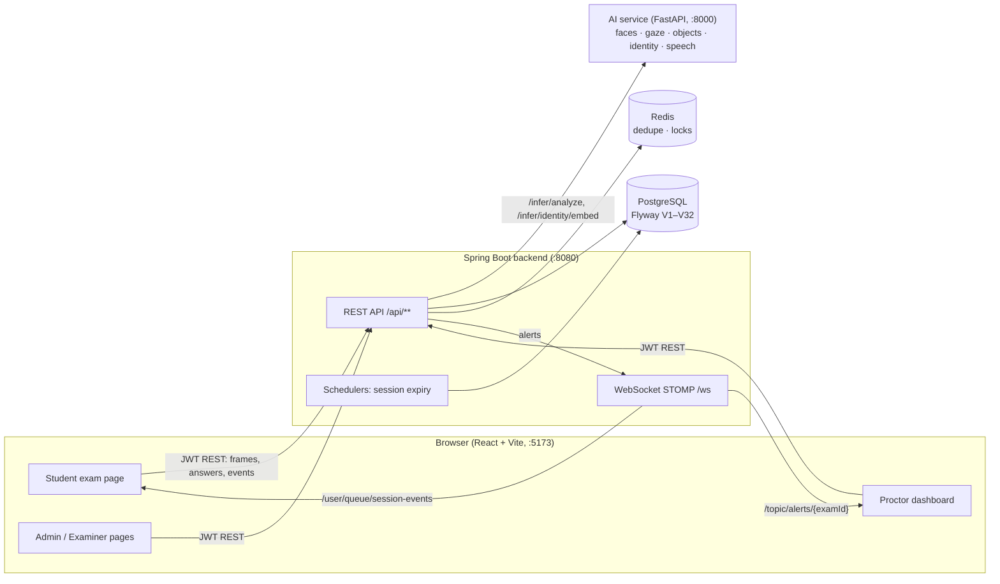
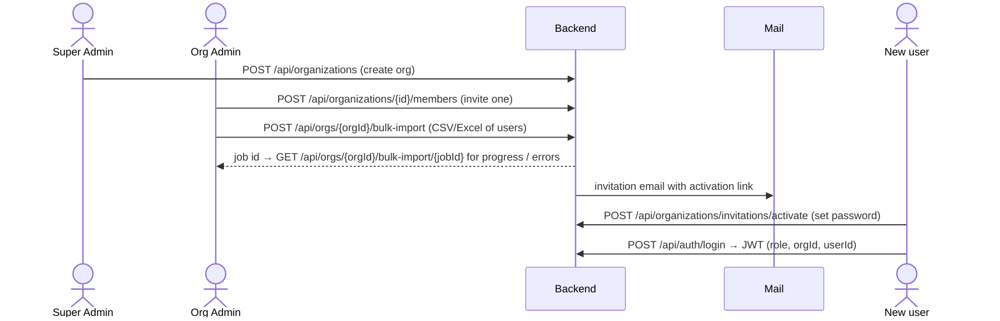
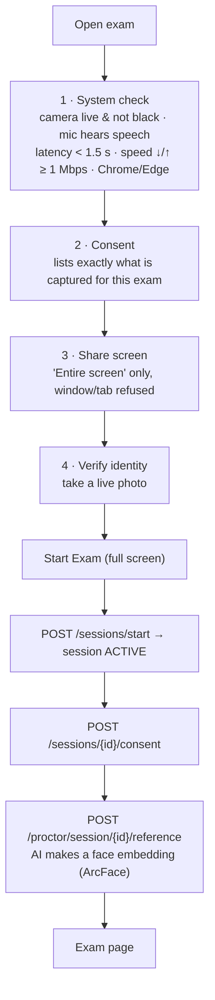
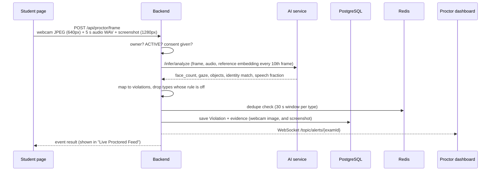
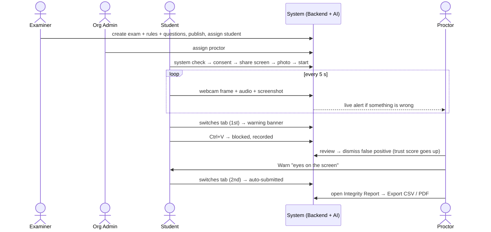

# Project Flow: AI Exam Proctoring System

How the whole system works, from an organization signing up to a proctor exporting an integrity report.
Read top to bottom: architecture, then each stage of the exam's life, then what happens behind the scenes.

---

## 1. The big picture

| Part | Job |
|---|---|
| **Frontend** (`frontend/`) | All screens. Talks to the backend with Axios (JWT in the header) and STOMP over SockJS for live messages. |
| **Backend** (`backend/proctorbackend/`) | All business rules: auth, organizations, exams, sessions, violations, trust score, reports. The only part that talks to the database and the AI service. |
| **AI service** (`backend/ai-service/`) | Stateless inference. Gets one webcam frame (plus optional audio and reference face) and returns what it saw. Never touches the database. |
| **PostgreSQL** | Everything permanent: users, exams, answers, sessions, violations, evidence images. |
| **Redis** | Short-lived state: violation de-duplication windows (30 s), and ShedLock for scheduled jobs. |

**Rule of thumb:** the AI service *detects*, the backend *decides*. Severities, de-duplication, per-exam rules, auto-submit
and termination are all decided server-side, so a student can't tamper with them from the browser.

---

## 2. Roles

| Role | Can do |
|---|---|
| **Super Admin** | Creates organizations, manages all users, sees everything. |
| **Org Admin** | Manages their organization: invites or bulk-imports students, examiners and proctors; assigns proctors to exams. |
| **Examiner** (`EXAM_CREATOR`) | Creates exams, questions and proctoring rules; assigns students; publishes. |
| **Proctor** | Watches live sessions of assigned exams, reviews violations, warns or terminates students, reads reports. |
| **Student** | Takes assigned exams. |

Every organization's data is separated by `organization_id`, so a user only ever sees their own organization's data
(multi-tenant SaaS).

---

## 3. Stage by stage

### Stage 1: Organization and people (onboarding)

- Bulk import runs as a background job (`BulkImportJob`), and per-row errors can be downloaded.
- Login returns a **JWT**. The frontend stores it and sends it as `Authorization: Bearer …` on every call.

### Stage 2: Exam setup (examiner and org admin)

1. **Create the exam**: `POST /api/exams` with title, duration, start and end time (sent in UTC), and the **proctoring rules**:

   | Rule | Default | Effect |
   |---|---|---|
   | Identity check | on | Live photo before the exam, re-verified every 10th frame |
   | Audio monitoring | on | Mic audio checked for speech |
   | Gaze tracking | on | Looking away is flagged |
   | Object detection | on | Phones, books and similar objects are flagged |
   | Screen monitoring | on | The entire screen must be shared; screenshots are kept as evidence |
   | Block copy & paste | on | Clipboard, right-click and shortcuts are blocked and recorded |
   | Tab-switch limit | 2 | Tab switches before auto-submit (0 = never) |
   | Max attempts | 1 | Attempts per student |

2. **Add questions**: `POST /api/questions`, with type MCQ, DESCRIPTIVE or CODING (coding answers can be run through
   Judge0 via `POST /api/code/run`).
3. **Publish**: `PATCH /api/exams/{id}/publish`.
4. **Assign students**: `POST /api/assignments` (or assign-all). **Assign a proctor**: `POST /api/exams/{id}/proctors`.

### Stage 3: The student starts the exam (pre-exam setup)

The student opens `/student/live-exam?examId=N`. The setup screen has 4 steps, and each unlocks the next:

- Steps turned off by the exam's rules are hidden (no mic check without audio monitoring, and so on).
- A slow network only shows a **warning**. Camera, mic and browser failures **block** the start.
- **Server-side gate:** until consent is recorded, `/proctor/frame` and `/reference` return **403**. Nothing is captured
  without consent.
- If the student stops sharing during setup, step 3 reopens, so the exam can't start unmonitored.

### Stage 4: During the exam (the proctoring loop)

**Every 5 seconds** the exam page sends one bundle:

**What the AI service checks** (`app/services/analysis_service.py`):

| Detector | Model | Becomes violation |
|---|---|---|
| Face detection | MediaPipe | `NO_FACE_DETECTED`, `MULTIPLE_FACES_DETECTED` |
| Gaze / head pose | MediaPipe Face Mesh | `LOOKING_AWAY` |
| Objects | YOLOv8n (ONNX) | `UNAUTHORIZED_OBJECT` (phone, book, …) |
| Identity | ArcFace (ONNX) vs the pre-exam photo | `IDENTITY_MISMATCH` |
| Voice activity | Silero VAD | `SPEECH_DETECTED` (if ≥ 30% of the chunk is speech) |

**What the browser watches** (sent to `POST /api/proctor/session/{id}/browser-event`, each with a webcam snapshot and
a screenshot):

| Event | Severity | Notes |
|---|---|---|
| `TAB_SWITCH`: tab hidden or window lost focus | HIGH | Counts toward the tab-switch limit, so it can auto-submit |
| `FULLSCREEN_EXIT` | MEDIUM | Blocking overlay until the student returns to full screen |
| `SCREEN_SHARE_STOPPED` | HIGH | Blocking overlay with **Resume sharing**; time away is recorded |
| `COPY_PASTE_ATTEMPT`: copy, cut, paste, right-click, Ctrl+P/S/U, F12, DevTools keys | LOW | Blocked plus a red toast; one per 30 s |

When the student comes back after leaving, `/browser-event/{id}/return` stores **how long they were away**.

**Answers** autosave: MCQ on click, text and code 1.5 s after typing stops. Pending answers are flushed before any
submit.

**Safety rules:**
- AI service down: the frame is skipped, so the student is **never penalised** for an outage.
- The same noisy violation within 30 s is stored once (Redis).
- A rule that is off for the exam: the server ignores or rejects that type (400).

### Stage 5: The proctor's live view

- The proctor dashboard subscribes to `/topic/alerts/{examId}`, so violations appear live.
- **Review** a violation: see the webcam snapshot and the screenshot, then **Confirm** or **Dismiss (false positive)**
  (`PATCH /api/violations/{id}/review`).
- **Live Sessions** tab:
  - **Warn**: `POST /api/sessions/{id}/warn`. A yellow banner appears on the student's screen via `/user/queue/session-events`.
  - **Terminate**: `PUT /api/sessions/{id}/terminate`. The student sees a notice and is sent to Results.

### Stage 6: How a session ends

| Trigger | Result status |
|---|---|
| Student clicks **Submit** | `COMPLETED` |
| Timer hits 00:00 (the client submits; the server scheduler also checks every 30 s) | `COMPLETED` |
| Tab switches reach the exam's limit | `COMPLETED` (auto-submitted) |
| 5 CRITICAL violations (`proctoring.violation.critical-threshold`) | `TERMINATED` |
| Proctor or admin clicks **Terminate** | `TERMINATED` |

The score is calculated on the server when the session ends. Descriptive answers stay "provisional" until graded.

**Reload mid-exam:** the session is resumed. Consent and the photo are *not* asked again, but the screen must be shared
again, and that gap is recorded as `SCREEN_SHARE_STOPPED` with its time away. Note that the reload itself counts as
leaving the window (`TAB_SWITCH`).

### Stage 7: Trust score and report

**Trust score** (computed when read, never stored): start at **100** and subtract for every violation that is
*not dismissed*.

| Severity | Penalty |
|---|---|
| LOW | −2 |
| MEDIUM | −5 |
| HIGH | −10 |
| CRITICAL | −20 |

Bands: **≥ 80 Trusted** (green), **50–79 Review** (amber), **< 50 Suspicious** (red). Dismissing a false positive raises
the score straight away.

**Integrity report** (`/reports/session/:id`, from `GET /api/sessions/{id}/report`):
- student, exam, attempt, times, score, trust score, **consent time**;
- violation counts by type and by severity;
- the full timeline, each entry with its webcam snapshot and screenshot;
- **Export CSV** and **Print / Save as PDF** (done in the browser).

The student's Results page shows the score and trust score only, not the individual violations.

---

## 4. One exam, end to end (the demo story)

---

## 5. Where things live in the code

| Concern | Backend (`backend/proctorbackend/src/main/java/com/proctor/proctorbackend/`) | Frontend (`frontend/src/`) |
|---|---|---|
| Login, JWT | `auth/`, `config/SecurityConfig.java`, `config/JwtAuthFilter.java` | `pages/Login/Login.jsx`, `services/api.js` |
| Organizations, invites, bulk import | `organization/`, `bulkimport/`, `mail/` | `pages/SuperAdmin/`, `pages/Organization/` |
| Exams, rules, questions | `exam/` (`ProctoringRules.java`), `question/`, `assignment/`, `examproctor/` | `pages/Examiner/`, `components/exam/ProctoringRulesFields.jsx` |
| Session start, end, consent, expiry | `session/SessionServiceImpl.java`, `session/SessionExpiryScheduler.java` + `SessionExpiryProcessor.java` | `pages/Student/LiveExam.jsx` |
| Pre-exam setup | n/a (frontend only) plus `common/SpeedTestController.java` | `components/exam/setup/*`, `utils/systemCheck.js`, `utils/screenShare.js` |
| Frame loop and AI | `proctoring/ProctoringServiceImpl.java`, `proctoring/AiServiceClient.java` | `components/exam/WebcamCard.jsx`, `utils/audioRecorder.js` |
| Browser lockdown | `proctoring/ProctoringServiceImpl.recordBrowserEvent` | `LiveExam.jsx` (lockdown effect), `hooks/useClipboardGuard.js` |
| Violations, evidence, trust | `violation/` (`TrustScoreService`, `ViolationEvidence`, `EvidenceKind`) | `components/common/EvidenceImage.jsx` |
| Live alerts, warn, terminate | `websocket/`, `session/ProctorActionService.java` | `pages/Proctor/ProctorDashboard.jsx`, `components/proctor/LiveSessionsPanel.jsx` |
| Report | `session/SessionReportService.java` | `pages/Reports/SessionReport.jsx` |
| AI inference | n/a | `backend/ai-service/app/services/*` (separate Python service) |
| Database schema | `src/main/resources/db/migration/V1…V32` | n/a |

---

## 6. Not built yet (future scope)

- Subscription billing and payments, audit log, departments.
- Room scan, phone as a second camera, full video recording, telling multiple speakers apart (pyannote).
- Evidence in object storage (S3/MinIO); today evidence images are stored in PostgreSQL.
- Migrations V25–V32 still need applying on the hosted database.
